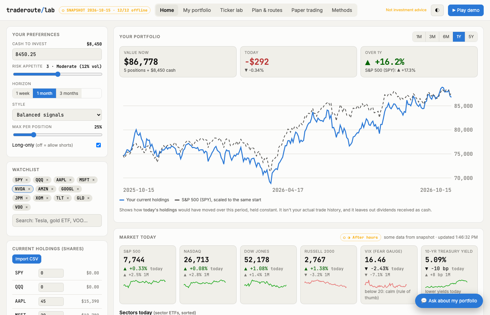
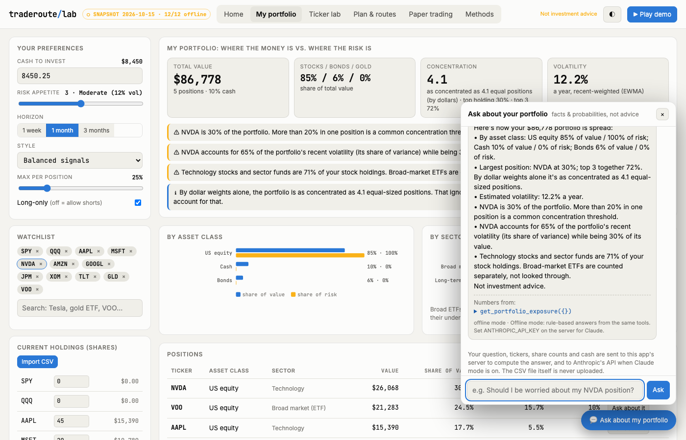

# TradeRoute Lab: honest stock forecasting and a preference-driven paper trader

**Finding first.** On five years of live daily data for 11 liquid tickers:
- **The forecasts are reasonably honest.** The 90% forecast bands contained **about 86–98%** of realized prices
  at ~99 overlapping past origins per ticker (effective n ≈ 47, about ±4 points), using only the data available at each origin.
- **The trading signals don't beat the market.** Across the watchlist, **0 of 44** signal/ticker pairs
  (momentum, trend, mean reversion, composite) clear an honest skill test.
- **So the tool doesn't predict direction.** It sizes risk to *your* preferences and shows the odds of every
  trade route: target first, stop first, or neither.

> ⚠️ **Education & simulation only. Not investment advice.** Paper trading only: no order ever leaves your browser.





## Quickstart
```bash
npm install
npm test            # 40 tests: known answers, NO-LOOKAHEAD, calibration, ERC, routes, data fallback, MCP e2e,
                    #   CSV import, exposure, offline chat
npm run demo        # starts http://localhost:4174 and opens the guided demo (17 steps)
npm start           # app only
npm run mcp         # MCP server: 7 tools (prices, analysis, backtests, plans, exposure, position risk, search)
npm run snapshot    # refresh the offline snapshot from live data
npm run test:ui     # headless Chromium: every tab, sample import, chat, phone width (once: npx playwright install chromium)
npm run build:static  # static demo in site/: no server, snapshot prices, rule-based chat
```
Requires Node 22+. `TRL_OFFLINE=1` uses only the bundled snapshot (no network). The chat uses Claude when
`ANTHROPIC_API_KEY` is set (model `claude-opus-5-5`, override with `TRL_CHAT_MODEL`); otherwise it answers
from the same tools with labeled rule-based replies. A recorded walkthrough of the guided demo is attached
to the GitHub release (`npm run demo:record` makes a new one).

**Static demo.** `npm run build:static` writes a copy of the app to `site/` that runs without the server: the browser
answers the app's API calls from the bundled snapshot with the same engine code (`web/static-api.js`), so prices are
the snapshot's and the chat is the rule-based one, and the page says so. The manual `pages` workflow publishes it to
GitHub Pages.

## What it does
| Layer | What you get |
|---|---|
| **Live data** | Yahoo v8 chart API (no key), adjusted OHLC, 15-min cache, real offline snapshot, and a LIVE/SNAPSHOT badge. The unfinished intraday bar is excluded from statistics. |
| **Market** | Watchlist table (return, volatility, Sharpe, max drawdown, beta, sparkline) and an EWMA correlation heatmap |
| **Ticker lab** | Price with 50/200-day averages; a **forecast fan** (filtered historical simulation, 2,000 paths) with P(up), a 90% range, VaR/CVaR and a **calibration score**; signals graded out of sample |
| **Plan & routes** | Preferences → equal-risk-contribution base, evidence-weighted tilt and target-vol scaling. **Routes**: ordered orders with ATR stops and targets, risk-budget sizing, tranches, and Monte-Carlo P(target first / stop first / neither) |
| **Paper trading** | One-click execution at live prices with slippage and costs, 60-second quote refresh, automatic stop/target triggers, P&L and an activity log |
| **Interactive layer** | Every preference (cash, risk 1–5, horizon, style, position cap, long-only, watchlist, holdings) re-plans instantly in the browser |
| **Your portfolio** | Import a Schwab, Fidelity or Robinhood CSV (parsed in the browser; the file never leaves your machine). The homepage graphs it against the S&P 500 next to today's indexes, VIX, 10-year yield and sector moves. A portfolio tab shows where the money is vs where the risk is, by asset class, sector and position. |
| **Search & chat** | Type "Tesla" to get TSLA with a short company card. A chat drawer answers questions like "Should I be worried about my NVDA position?" with facts and probabilities from the tools, never advice, and shows which tools produced each number. It sends tickers, share counts and cash to the local server, and to Anthropic's API when Claude mode is on. |
| **Agents** | The same engine as an MCP server (`server/mcp.js`, sharing its logic with `engine/tools.js`) |

## How it works
```
engine/  (pure ESM, zero deps; runs in browser, server, MCP and tests)
  stats.js      returns, vol, Sharpe/Sortino, drawdown, beta, EWMA (λ 0.94), RSI, ATR, exact binomial test
  forecast.js   FHS: re-centered EWMA-standardized bootstrap, drift 0 → fan, P(up), VaR/CVaR; calibrate()
  signals.js    momentum 12-1, trend 50/200, RSI mean reversion (fixed literature parameters, no fitting)
  backtest.js   1-day execution lag, costs, exposure-matched benchmark, symmetric |t| > 3 verdicts, base-rate hit test
  portfolio.js  ERC (coordinate descent) → evidence-weighted tilt → vol-seeking dial → caps (excess to cash)
  routes.js     sells → buys, risk-capped sizing, ATR stop/target, tranches, first-passage probabilities
  universe.js   default symbols, market summary, quotes, offline name search (shared by server and static demo)
  chat-offline.js  portfolio validation and the rule-based chat answerer (shared by server and static demo)
server/  data.js (live → cache → snapshot, with provenance) · http.js (port 4174) · mcp.js · chat.js (Claude loop)
web/     preferences rail, market, ticker lab, plan & routes, paper trading, methods, guided tour;
         static-api.js (static demo only)
scripts/ build-static.mjs → site/
```
Equations, assumptions and sources (verification status in `coordination/SOURCES.md`) are in the in-app **Methods** tab (`web/methods.js`).

## Validation
- **No lookahead:** perturbing future prices never changes past positions or past equity, for every signal.
- **Honest tests:**
  - On random walks the skill test finds ≤ 1 false discovery in 30 trials.
  - Buy & hold is "right" exactly at the base rate.
  - A half-exposure copy of buy & hold scores t ≈ 0.
- **Calibration:** 90% bands cover 80–98% of real outcomes (SPY, NVDA, TLT).
- **Portfolio:**
  - risk contributions are equal to within 1%
  - caps always hold
  - the risk dial never lowers volatility
- **Routes:**
  - cash never goes negative
  - a stop-out never loses more than the risk budget
  - zero-drift symmetric brackets come out ≈ 50/50 on real data
- **Independent audit:** a coordinator agent found 3 high-severity issues (a non-converging risk-parity solver,
  a hit-rate test against 50% instead of the base rate, and a skill test that confused exposure with skill).
  All are fixed and covered by regression tests. See `coordination/REVIEW.md`.
- **In a browser, on every push (CI):** headless Chromium opens every tab, imports the sample portfolio, asks the
  chat a question and checks phone width, against both the Node server and the static demo; any console error,
  failed request or sideways scroll fails the build.

## Limits
- Daily bars only.
- Stops are checked on closes; real stops can gap.
- Five years is one market regime.
- The watchlist is today's winners (selection bias).
- No taxes or borrow costs.
- Paper trading simulates long positions only; shorts appear in routes but aren't booked.
- The Yahoo endpoint is unofficial and can change without notice.
- Data comes from Yahoo's unofficial endpoint; the bundled snapshot is for offline demos and tests only.

## License
MIT (code). Market data in `data/snapshot/` belongs to its providers.
